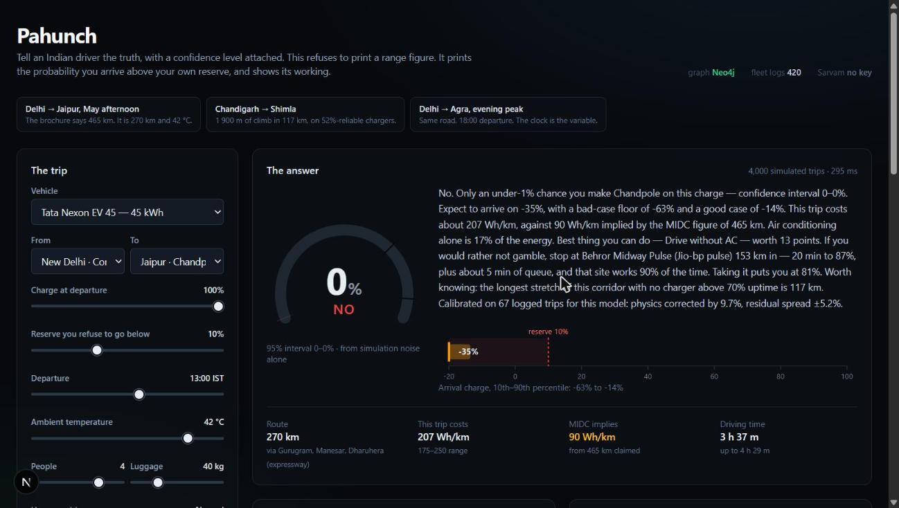

# Pahunch

**Tell an Indian driver the truth, with a confidence level attached.**

hackFront India 2026 · Problem statement 01, *Will I Make It* · General Track

---

An electric vehicle claims a range. The claim is measured on a dynamometer, on a
cycle designed for repeatability, with no air conditioning, one occupant, no
gradient and no traffic. Then someone drives it from Delhi to Jaipur in May with
four people and the AC on, and discovers the figure was never a promise.

The usual fix is a better number — a "real-world range" estimate. That is still
the wrong shape of answer, because the honest answer is not a number. Whether
you make it depends on the forecast being right, on traffic you cannot see yet,
on your own right foot, and on whether the charger at Behror is working today.
Those are distributions, not constants.

So Pahunch refuses to print a range figure. It answers the question that was
actually asked:

```
Delhi (Connaught Place) → Jaipur · Tata Nexon EV 45 · 100% · 13:00 · 42 °C · 4 people · AC on

   P(arrive above your 10% reserve) = 0.1%            [NO]
   Arrival charge:       -63% / -35% / -14%  (p10 / p50 / p90)
   This trip costs:      207 Wh/km     MIDC 465 km claim implies 90 Wh/km
   Biggest lever:        drive without AC, +13 points
   If you would rather
   not gamble:           Behror Midway Pulse, 153 km in, 20 min to 61%,
                         site delivers charge 90% of the time → 81%
```

The MIDC figure implies 90 Wh/km. This trip costs 207. That gap is the product.



---

## Why a probability, and why you can trust this one

Anyone can print a percentage. The number is only worth anything if it is
*calibrated* — if the trips it calls 80% actually succeed about 80% of the time.
That is checkable, so it is checked:

```
npm run validate
```

On 118 trips the calibration layer never saw:

| | Brier score (lower is better) |
|---|---|
| **Pahunch** (calibrated, probabilistic) | **0.112** |
| Physics point estimate, uncalibrated | 0.195 |
| The nameplate range figure | 0.542 |
| Always guessing the base rate | 0.234 |

- **Expected calibration error 0.067.** The reliability diagram is printed in
  full, bin by bin, so you can see where it is weakest rather than taking one
  summary statistic on faith.
- **Brier skill score 0.520** against the base rate.
- The calibration recovers each vehicle's hidden efficiency offset to within
  **0.022** — see *What is real and what is not*, below.

The script asserts five success criteria and **exits non-zero if any of them
fail**. It is a test, not a report.

---

## How it works

Four layers, each doing one job.

### 1. Physics — `lib/energy/physics.ts`

Per-segment energy integration: rolling resistance, aerodynamic drag, gradient,
stop-go kinetic losses, regenerative braking, and accessory load. Nothing exotic;
the care is in the India-specific terms that general-purpose models skip.

- **Air density from the barometric formula.** Delhi at 45 °C is about 12% below
  ISA density and Shimla at 2 200 m is 23% below it. Both cut the drag term
  measurably.
- **HVAC as a first-class load.** A 3.2 kW compressor sustained at 45 °C, at an
  urban mean speed of 18 km/h, is roughly 178 Wh/km of pure accessory draw —
  comparable to the entire traction demand of the same car on an expressway.
  Heating is modelled too, and PTC resistive heaters are worse per degree than
  cooling.
- **Gradient that actually bites.** Chandigarh → Shimla climbs 1 900 m in 117 km.
  Run it in reverse and the model returns energy to the pack, which is correct.
- **The clock advances along the route.** A trip leaving Delhi at 17:00 hits the
  evening peak on its first hundred kilometres and clear road afterwards.
  Applying one traffic factor to a 270 km corridor gets this materially wrong.
- **Charging that tapers.** A 20→80% session is not `energy / powerKw`. Real DC
  sessions hold near-rated power to about 50% and fall away after, and a 17 kWh
  pack cannot swallow a 150 kW gun whatever the gun is rated at.

### 2. Calibration — `lib/energy/calibration.ts`

A physics model of a car is not merely noisy, it is *biased*, consistently, per
model, because of everything it leaves out. Attach a confidence interval to a
biased estimate and the interval is centred in the wrong place.

So every logged trip is replayed through the model and the ratio of observed to
predicted energy is fitted in log space. The mean becomes a multiplicative bias
correction; the spread becomes model error. Vehicles with few logged trips are
shrunk toward no correction via a normal-normal conjugate update, so four noisy
trips do not buy a confident 11% correction.

**The part that took a bug to get right.** The first version measured residual
spread with traffic, wind, load and driving style held at their expected values.
That residual therefore already contained the variance those four things
contribute — and the Monte Carlo then sampled all four again and multiplied the
residual on top. The same uncertainty was counted twice, the arrival distribution
came out too wide, and the probabilities collapsed toward 50%: the harness showed
84% calls succeeding 100% of the time and 16% calls succeeding 7% of the time,
with an ECE of 0.099.

The fix is a variance decomposition. Each logged trip is now predicted as a
*distribution* drawn from the same sampler the predictor uses
(`lib/energy/conditions.ts`, shared by both for exactly this reason). The variance
that sampler explains is subtracted, and only the remainder is carried forward as
model error. ECE fell to 0.067 and the reliability diagram straightened out.

### 3. Uncertainty — `lib/energy/montecarlo.ts`

Four thousand simulated trips per verdict, sampling ambient temperature, traffic,
driver variation, headwind, tyre and surface condition, HVAC duty cycle, and the
measured model error. Every spread is justified in a comment at the point it is
drawn, because a made-up spread produces made-up confidence.

Two derived views, both computed by genuine re-simulation rather than heuristic:

- **Where the doubt comes from.** Each uncertainty source is pinned to its
  expected value and the change in P is reported. This is a one-at-a-time
  sensitivity, so the deltas do not sum to the total and are not meant to — they
  answer "what would I have to know to stop guessing".
- **What would change my mind.** Actionable levers, each a full re-run under a
  changed request: drive without AC, ease off 10 km/h, leave at a different hour
  (all 24 are scanned), travel lighter, accept a lower reserve. Consistent with
  the headline by construction.

A quietly interesting result falls out: with the AC off, traffic *uncertainty*
works in the driver's favour, because slower is cheaper once the compressor is
not running. The model finds that without being told.

### 4. The graph — Neo4j

The road network is a graph and the questions are graph questions.

- **Route enumeration** — weighted path search with `reduce` over relationships
  to turn a path into a scalar cost. The in-process fallback implements Yen's
  k-shortest paths so both backends behave the same.
- **Reachable chargers** — bounded traversal with a distance accumulator, used as
  a coarse filter to narrow two dozen sites to the handful worth simulating
  properly. Full physics inside Cypher would be slow and the wrong place for it.
- **Corridor coverage** — the one that earns the graph database, and the one
  that took two attempts.

  The first version asked "what is the probability at least one charger on this
  corridor is working": `1 - Π(1 - reliability)` over every site on the path.
  Elegant, and useless — with seven to ten sites the answer is `1.0000` for
  every corridor, so it could not tell the Jaipur expressway apart from the
  Shimla ghat. A metric that is the same for every input is decoration.

  What a driver is exposed to is not "is there a working charger on this road"
  but "how far must I go with no dependable option". So Cypher returns each
  waypoint with its distance into the trip and the composed odds that something
  dependable there works — `reduce` doing double duty, once for cumulative
  distance along the relationships and once for the product over reliabilities —
  and the caller reduces that to the longest uncovered stretch.

  On Delhi → Shimla the answer is **117 km**: every dependable site is on the
  plains, and the entire ghat climb from Chandigarh has nothing above 70%
  uptime. On Delhi → Agra it is 72 km. The metric now distinguishes corridors,
  which is the whole point of having it.

Charger **reliability** is the field that matters and the one no public charger
map exposes: the share of attempted sessions that actually delivered charge. A
0.52 site on the Solan climb is a materially different object from a 0.92 site at
Murthal, and treating both as "a charger" is how people get stranded. The stop
planner scores a candidate on `P(reach it) × P(it works) × P(finish from there)`,
which is why it routinely passes over the nearest charger.

**The app runs with Neo4j and without it.** Same shapes, same searches, and the
UI states which one answered — a silent downgrade would be worse than a failure,
because you would not know which numbers you were reading. When it does fall
back it says *why*, on the server console and in the `/api/graph` response. That
is not politeness: the three queries that load the graph were originally fired
with `Promise.all`, which a Neo4j session rejects because it holds one
transaction at a time, and the only symptom was a badge reading "bundled" with a
freshly seeded database sitting right there. An unexplained fallback hides bugs.

### Sarvam — Indian-language output

The driver who most needs an honest answer is not reading Wh/km in English. The
verdict is generated once in English, then translated and voiced in ten
languages. `mode: "modern-colloquial"` is deliberate: the formal register turns
"87% confidence" into something nobody says out loud.

Degrades in every direction. No key, a rate limit, a dropped request — the caller
gets English back with `available: false` and a stated reason.

---

## Running it

```bash
npm install
npm run dev          # http://localhost:3000
```

That is all of it. No API key, no database, no map tile server. The bundled graph
and the fleet logs ship with the code, and the page loads straight into a real
answer rather than an empty form.

Optional extras:

```bash
cp .env.example .env     # then edit

docker compose up -d     # Neo4j on bolt://localhost:7687
npm run seed             # load the network; prints corridor reliability to prove it worked
npm run seed -- --wipe   # clean reload (only touches Place and Charger nodes)
```

Set `SARVAM_API_KEY` in `.env` for translation and speech.

```bash
npm test             # 83 tests
npm run validate     # calibration harness, exits non-zero on failure
npm run typecheck
npm run build
```

The tests are not decoration either. They caught a `chargeMinutes` that made a
cold pack charge *faster* than a warm one (the temperature derate was applied to
the energy going in as well as the rate limit), and the seed script asserts that
the longest corridor in the network still returns a path — a hop bound of 9 in
the Cypher silently found no route for Delhi → Shimla, which is ten segments.

---

## What is real and what is not

Worth being direct about, because a demo that overstates its data is worth less
than one that does not.

**Real:** the physics, the calibration machinery, the uncertainty sampling, the
graph queries, the validation harness. All of it would work unchanged against a
production telematics feed.

**Hand-built:** the road network — 24 waypoints across the Delhi NCR corridors
(NH48 to Jaipur, the Yamuna Expressway to Agra, NH44 to Chandigarh, the ghat
climb to Shimla), with real distances, elevations and charger operators.
Per-hour traffic curves and charger reliability figures are plausible values for
each road and operator class, not a licensed dataset.

**Synthetic:** the fleet logs, in `lib/data/trips.ts`, and that file explains
itself at length. They are not the physics model echoing itself back:

1. Each vehicle gets a **hidden efficiency offset** the model cannot see,
   standing in for pack ageing, inverter losses off the efficiency island, tyre
   choice and BMS conservatism.
2. Observed energy is the prediction under the trip's *true* conditions, times
   that offset, times lognormal trip noise.
3. The conditions stored on each log are **degraded** copies of the true ones — a
   driver who logs "two people, no AC" when it was three with the AC running.

The validation harness then checks that calibration recovers each hidden offset
from the degraded logs, and that the resulting probabilities are honest on trips
it never saw. If the logs were real, only that one file would change.

---

## Known limitations

Stated rather than discovered later:

- **Single charging stop.** The planner evaluates one stop. A 24 kWh Tiago going
  Delhi → Agra at 18:00 needs two, and the plan it returns is the best single
  stop rather than the best plan. This is the most worthwhile next piece of work.
- **No live traffic or weather.** Traffic comes from static per-hour curves per
  segment and ambient temperature is a user input. Both are the right shape to
  accept a live feed; neither has one.
- **Ambient stands in for pack temperature**, which is wrong for the first twenty
  minutes of a trip and close enough after that.
- **Calibration cannot fix an absolute physics error** when it is graded against
  logs generated from the same physics. It demonstrably removes a per-vehicle
  offset; it cannot prove the underlying model is right in absolute terms. Only
  real telematics can, and that is the first thing we would ask a partner for.
- **The verdict thresholds** (0.92 for "yes", 0.70 for "tight") are a judgement
  call. They are stated in the code and in the UI rather than buried.
- **Sarvam request shapes** are written to the documented API and exercised
  through the degradation path; they have not been run against a live key.
- **Scooter consumption is probably optimistic.** The model puts an Ather 450X
  two-up at about 20 Wh/km in city traffic, a little under its IDC claim, where
  owners report 25–30. A certification cycle should be optimistic, not
  pessimistic, so the physics is likely light on something — rider drag, DC-DC
  losses, or BMS overhead. Calibration cannot catch it, for the reason in the
  bullet above. It is not tuned toward the expected figure, because fitting a
  model to a number somebody remembers is not calibration.

---

## Layout

```
app/
  api/estimate/    POST a trip, get a verdict (zod-validated, 400/422/500 distinguished)
  api/graph/       network, vehicles, calibration state, languages — one round trip
  api/explain/     Sarvam translation and speech
lib/
  types.ts         the domain, with units in the field names
  rng.ts           seeded RNG; every verdict is reproducible
  estimate.ts      orchestration and sample budget
  energy/
    physics.ts     per-segment energy integration
    conditions.ts  the shared nuisance sampler (see the calibration note)
    calibration.ts bias fitting and variance decomposition
    montecarlo.ts  simulation, sensitivity, levers, stop planning
    vehicles.ts    seven Indian EVs
  graph/
    queries.ts     Cypher
    provider.ts    Neo4j with a transparent in-process fallback
    routing.ts     Yen's k-shortest paths
  data/
    network.ts     the road network
    trips.ts       synthetic fleet logs, honestly labelled
scripts/
  seed-neo4j.ts        idempotent loader
  validate-calibration.ts   the harness that grades the confidence number
```

Next.js 15, TypeScript strict, Tailwind, Vitest. Every visualisation is
hand-rolled SVG — no charting library and no map tiles, because the demo has to
work on a venue wifi that cannot reach a CDN.

### Submission material

`submission/` holds the hackFront India deliverables: the prototype deck
(`Pahunch-prototype-submission.pptx`), the written problem statement
(`problem-statement.md`), and the demo recording script.

